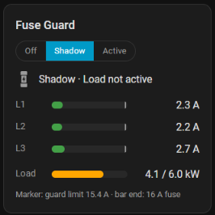
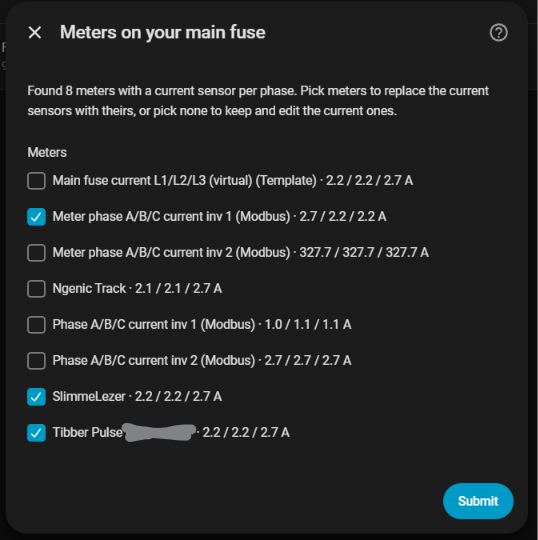
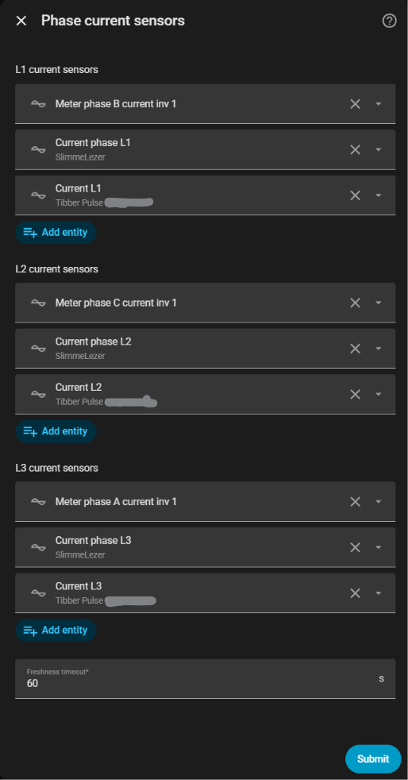
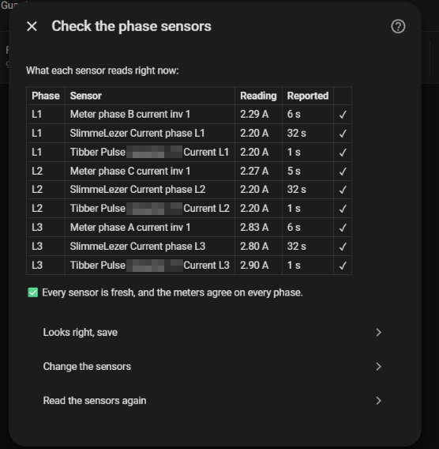
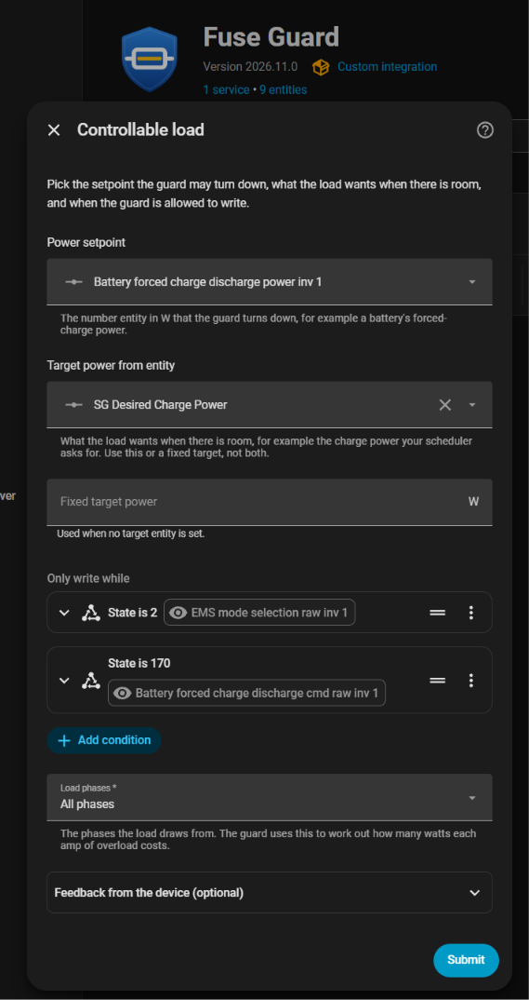
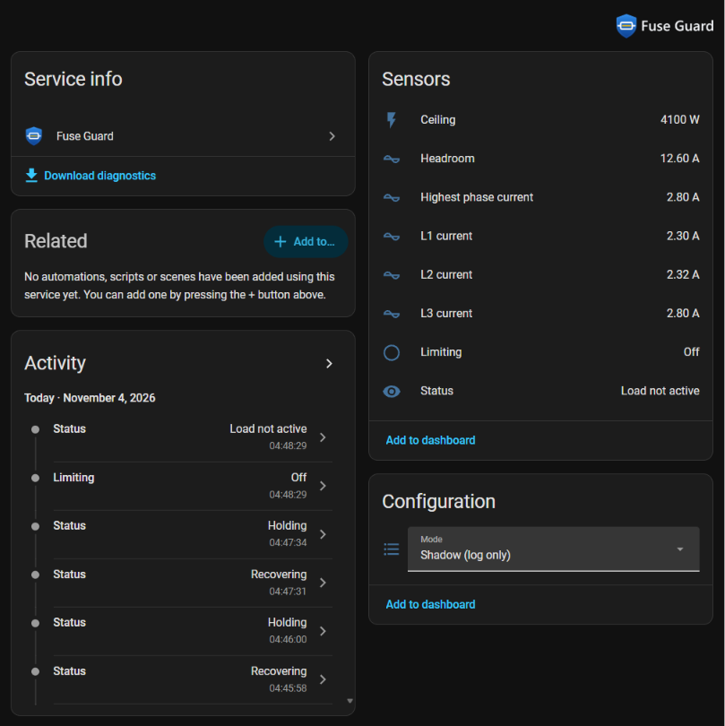

#  Fuse Guard

A Home Assistant integration that keeps every phase of your main fuse below
its rating by turning down one controllable load: a home battery's grid
charging, a heat pump's power limit, anything with a power setpoint in watts.

Charging a battery from the grid at night is cheap, until the dishwasher, the
heat pump and the battery all land on the same phase and the main fuse trips.
Fuse Guard watches each phase and trims the load just enough to stay under
the limit, then gives the power back once there is room.



- **Uses every meter you have.** Each phase reads as the highest fresh value
  among its meters, so a slow or failed meter never hides an overload.
- **Cuts fast, in proportion.** The cut matches the overload, and a second
  cut waits for a reading taken after the load has had time to respond, so it
  doesn't overshoot.
- **Gives power back in steps** as headroom returns, so a heat pump or a
  dishwasher that is ramping up can settle first.
- **Plays well with schedulers.** It only changes the setpoint while your
  conditions hold (for example "the battery is in forced-charge mode"), and
  never changes the load's mode, so evcc or your own automations stay in
  charge of *when*.
- **Fails safe.** If the meters go quiet while the load is active, it pauses
  the load instead of guessing.
- **Shadow mode** shows what it would do, in the logbook and on its card,
  before it is allowed to write anything.
- **Guided setup.** It finds your meters, shows what each sensor reads right
  now, and catches swapped phases before you save.
- **A dashboard card** comes with it, with nothing extra to install.

> [!IMPORTANT]
> Fuse Guard reacts within seconds, but it is software running on Home
> Assistant. It helps you avoid tripping the main fuse; it does not replace
> it, and it can't protect anything while Home Assistant is down.

## Requirements

- Home Assistant 2025.1 or newer. The integration's icon shows from 2026.3.
- At least one sensor per phase that reports the current through the main
  fuse in amps: a P1/DSMR reader, a Tibber Pulse, an inverter's grid meter,
  a clamp meter, and so on. More meters are better.
- A load you can turn down through a `number` entity in watts, for example
  a battery inverter's forced-charge power (Sungrow, Huawei, GoodWe… through
  their Modbus integrations) or a heat pump's power limit.

Setpoints in amps (EV chargers) and switched loads behind smart plugs are on
the roadmap ([docs/DESIGN.md](https://github.com/ulfben/ha-fuse-guard/blob/main/docs/DESIGN.md), section 10).

## Installation

### HACS

1. HACS → ⋮ → **Custom repositories** → add
   `https://github.com/ulfben/ha-fuse-guard` as an **Integration**.
2. Search for **Fuse Guard**, install it, and restart Home Assistant.

### Manual

Copy `custom_components/fuse_guard` into your `config/custom_components/`
folder and restart Home Assistant.

After installing or updating, reload the Home Assistant page in your browser
(Ctrl+F5) so it picks up the integration's new texts and card.

## Setup

Settings → Devices & services → **Add integration** → **Fuse Guard**.

1. **Main fuse.** The fuse rating, the number of phases, and a safety margin.
   The guard starts cutting at fuse minus margin: 15.4 A for a 16 A fuse
   with the default 0.6 A.
2. **Meters on your main fuse.** Fuse Guard lists the meters it found, each
   with what it reads right now. Tick the ones that measure the whole house.
   Meters on the main fuse agree with each other; an inverter's own output or
   a single circuit won't.

   

3. **Phase current sensors.** The ticked meters' sensors, filled in per
   phase. Change anything you like.

   

4. **Check the phase sensors.** A table of every sensor's current reading,
   with warnings for stale, implausible, duplicated or disagreeing sensors.
   Meters that label phases A/B/C are first filled in as A = L1, B = L2,
   C = L3, which often isn't how they are wired. When the readings show
   another order fits better, the check offers to apply it. When two phases
   happen to carry the same current, it says so instead of guessing; read
   again when the loads differ.

   

5. **Controllable load.**
   - **Power setpoint:** the `number` entity the guard turns down.
   - **Target power:** what the load wants when there is room, as a fixed
     value or from an entity (for example the charge power your scheduler
     asks for).
   - **Only write while:** conditions, built like an automation's, that say
     when the load is active. Example for a battery that evcc puts into
     forced charge: *State: EMS mode is 2* and *State: charge command is
     170*. Leave it empty if the load is always active.
   - **Load phases:** which phases the load draws from.
   - **Feedback from the device** (optional, folded away): **Setpoint
     readback** and **Actual power**, sensors for the value the device
     actually holds and the power it actually draws, and which sign that
     power has. With them, the guard won't give more power to a load that
     isn't following.

   
6. **Check the load.** What those entities read right now, and a warning if,
   for example, the actual power has the wrong sign.

A new guard starts in **Shadow** mode. Watch its decisions for a few days,
then switch **Mode** to **Active**.

Everything can be changed later under **Configure**, which also has the
advanced timing settings.

## Entities

| Entity | What it shows |
|---|---|
| Mode | Off, Shadow (decide and log, never write) or Active |
| Status | What the guard is doing: full rate, limiting, recovering, holding, load not active, fail safe… The `summary` attribute is a plain-language line for dashboards |
| Ceiling | The highest setpoint the guard currently allows (W) |
| L1/L2/L3 current | The highest fresh reading per phase; attributes name the source meter and how far the meters disagree |
| Highest phase current, Headroom | The worst phase, and how far below the limit it is |
| Limiting | On while the guard holds the load below its target |
| Target power | Only when the target is a fixed value |

Every write shows in the logbook ("set number.… to 5000 W: THROTTLE; …") and
fires a `fuse_guard_action` event you can use in automations. In Shadow mode
the logbook says "would set" instead.



## Dashboard card

Edit a dashboard → **Add card** → **Fuse Guard**. It shows each phase against
the fuse (the marker is the guard's limit), the load against its target, the
status line, a mode switch (it asks before going Active) and, optionally, the
last decisions.

```yaml
type: custom:fuse-guard-card
entity: sensor.fuse_guard_status
show_log: true
```

The integration adds the card to **Settings → Dashboards → Resources** for you,
so browsers and the HA app both load it. If your resources are set up in YAML,
it can't add one there; it loads the card through the page instead, which the
HA app may miss. In that case add `/fuse_guard/fuse-guard-card.js` as a
JavaScript module resource yourself.

## How it decides

Every few seconds, and whenever a meter reports:

1. **An overload** (the worst phase at least 0.2 A over the limit) cuts the
   setpoint by 310 W plus the overload converted to watts
   (230 V × 3 phases = 690 W per amp for a three-phase load).
2. **After a cut** it waits for a meter reading taken at least 8 s later
   before deciding whether to cut again, so it doesn't react to its own
   past.
3. **After a cut, or when the guard starts up,** it waits 60 s before
   giving any power back.
4. **Then it recovers in steps** of 60 % of the measured headroom, at most
   once a minute, and only while the load is following its setpoint.
5. **Missing or stale data** while the load is active pauses the load
   (or holds the setpoint, if you choose that).

These steps were replayed against real overloads with a simulated battery;
see [docs/DESIGN.md](https://github.com/ulfben/ha-fuse-guard/blob/main/docs/DESIGN.md) for the design and the results.

<details>
<summary>Advanced settings and their defaults</summary>

| Setting | Default | Meaning |
|---|---|---|
| Evaluation interval | 10 s | How often the guard checks, besides on every meter report |
| Minimum overload | 0.2 A | How far over the limit counts as a real overload |
| Base cut | 310 W | The fixed part of each cut |
| Time between cuts | 10 s | Minimum time between two cuts |
| Response time | 8 s | A further cut needs a reading taken at least this long after the last one |
| Cooldown after a cut | 60 s | No recovery for this long after a cut or a start |
| Settling time | 30 s | The setpoint must have been unchanged this long before a recovery step |
| Time between recovery steps | 60 s | |
| Recovery gain | 0.6 | Share of the measured headroom given back per step |
| Step size | 100 W | Setpoint granularity |
| Startup hold | 60 s | After a start, the guard waits this long before acting on its readings |
| On missing data | Pause the load | Or hold the current setpoint |

The defaults suit a battery that follows a new setpoint in about 10 s.

</details>

## Troubleshooting

- **Labels missing or the card not found after an update:** reload the page
  with Ctrl+F5. In the HA app: Settings → Companion app → Troubleshooting →
  Reset frontend cache.
- **Status stays at Fail safe:** a phase has no fresh reading, the readback is
  stale, or the target isn't a number. Configure → Phase current sensors
  shows which sensor is the problem.
- **To see what it decided and why:** the Status sensor's `message` attribute,
  the logbook, or Settings → Devices & services → Fuse Guard → ⋮ →
  **Download diagnostics**, which includes the last 50 decisions.

## Development

```bash
uv venv && uv pip install -r requirements_test.txt
uv run pytest
```

The decision logic (`controller.py`) and the meter checks (`meters.py`) are
plain Python with no Home Assistant imports, so they can be tested directly.
`tests/test_replay.py` replays recorded overloads through the controller.

## License

[MIT](https://github.com/ulfben/ha-fuse-guard/blob/main/LICENSE) © Ulf Benjaminsson
