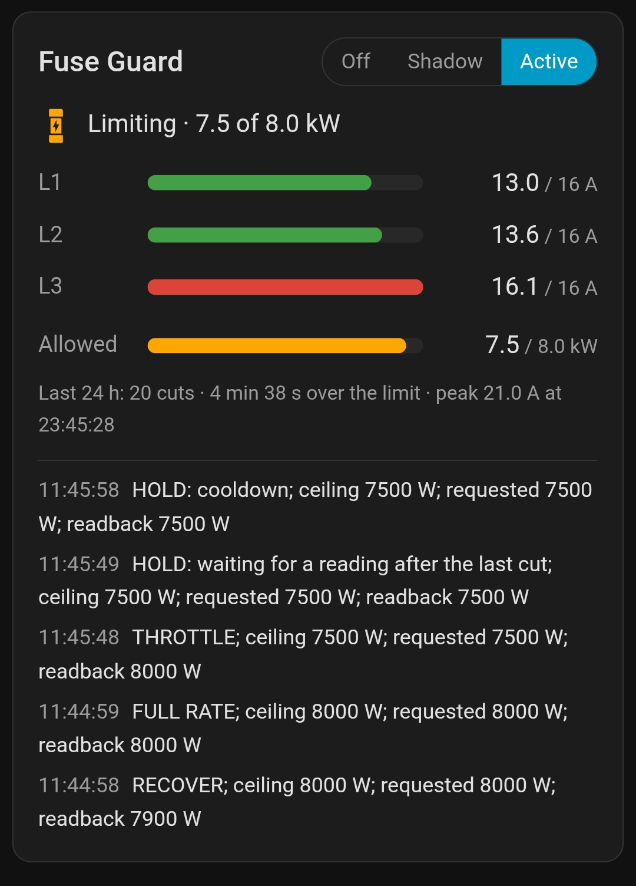

#  Fuse Guard

[](https://github.com/ulfben/ha-fuse-guard/actions/workflows/validate.yml)
[](https://github.com/ulfben/ha-fuse-guard/releases/latest)
[](https://hacs.xyz/)

A Home Assistant integration that keeps every phase of your main fuse below
its rating by turning down one controllable load: a home battery's grid
charging, a heat pump's power limit, anything with a power setpoint in watts.

Charging a battery from the grid at night is cheap, until the dishwasher, the
heat pump and the battery all land on the same phase and the main fuse trips.
Fuse Guard watches each phase and trims the load just enough to stay under
the limit, then gives the power back once there is room.



*The card during a real cut: L3 went just over the limit, so the guard
trimmed the battery from 8.0 to 7.5 kW, waited for a reading taken after the
cut, then held through the cooldown before giving power back.*

- **Uses every meter you have.** Each phase reads as the highest fresh value
  among its meters, so a slow or failed meter never hides an overload.
- **Cuts fast, in proportion.** The cut matches the overload, and a second
  cut waits for a reading taken after the load has had time to respond, so it
  doesn't overshoot.
- **Gives power back in steps** as headroom returns, so a heat pump or a
  dishwasher that is ramping up can settle first.
- **Plays well with schedulers.** It only changes the setpoint while your
  conditions hold (for example "the battery is in forced-charge mode"), and
  never changes the load's mode, so evcc or your own automations stay in
  charge of *when*.
- **Fails safe.** If the meters go quiet while the load is active, it pauses
  the load instead of guessing.
- **Shadow mode** shows what it would do, in the logbook and on its card,
  before it is allowed to write anything.
- **Guided setup.** It finds your meters, shows what each sensor reads right
  now, and catches swapped phases before you save.
- **A dashboard card** comes with it, with nothing extra to install.

> [!IMPORTANT]
> Fuse Guard reacts within seconds, but it is software running on Home
> Assistant. It helps you avoid tripping the main fuse; it does not replace
> it, and it can't protect anything while Home Assistant is down.

## Requirements

- Home Assistant 2025.1 or newer. The integration's icon shows from 2026.3.
- At least one sensor per phase that reports the current through the main
  fuse in amps: a P1/DSMR reader, a Tibber Pulse, an inverter's grid meter,
  a clamp meter, and so on. More meters are better.
- A load you can turn down through a `number` entity in watts, for example
  a battery inverter's forced-charge power (Sungrow, Huawei, GoodWe… through
  their Modbus integrations) or a heat pump's power limit.

Setpoints in amps (EV chargers) and switched loads behind smart plugs are on
the roadmap ([docs/DESIGN.md](https://github.com/ulfben/ha-fuse-guard/blob/main/docs/DESIGN.md), section 10).

## Installation

### HACS

Fuse Guard is in the HACS default list. Open HACS (called **Marketplace**
from Home Assistant 2026.11), search for **Fuse Guard**, install it, and
restart Home Assistant.

If it doesn't show up in the search, add it as a custom repository instead:
HACS → ⋮ → **Custom repositories** → add
`https://github.com/ulfben/ha-fuse-guard` as an **Integration**, then search
again.

### Manual

Copy `custom_components/fuse_guard` into your `config/custom_components/`
folder and restart Home Assistant.

After installing or updating, reload the Home Assistant page in your browser
(Ctrl+F5) so it picks up the integration's new texts and card.

## Setup

Settings → Devices & services → **Add integration** → **Fuse Guard**.

Setup takes six short steps. You describe your fuse, show the guard where to
measure it, and tell it which load it may turn down. Each step shows live
readings and warns about anything that looks wrong, so you can see whether a
choice makes sense before you go on. The list below follows the steps in the
order the setup shows them.

1. **The main fuse.** First, the guard needs to know what it is protecting:
   the fuse rating, the number of phases, and a safety margin. The guard
   starts cutting at the fuse rating minus the margin, so with a 16 A fuse
   and the default 0.6 A margin it acts at 15.4 A. The margin leaves room
   for the meters' delay and for loads that switch on between two readings.

2. **The meters on your main fuse.** Second, the guard needs to know which
   devices can measure the current through the main fuse. It lists every
   meter it found, each with what it reads right now. Tick the ones that
   measure the whole house: a smart meter reader, an energy meter on the
   incoming supply, or the grid meter of a solar or battery inverter. Meters
   that sit on the main fuse agree with each other. An inverter's own
   output, or a meter on a single circuit, won't, and the readings next to
   each meter make that easy to spot. Tick several if you have them: the
   guard uses the highest fresh reading per phase, so one slow or failed
   meter never hides an overload.

   

3. **The phase current sensors.** Third, the guard turns the meters you
   ticked into one list of current sensors per phase, and fills them in for
   you. Check that the sensors on each phase belong together. A common
   problem is a meter whose current clamps sit on different phases than its
   labels say, so its "phase A" is really your L2 or L3. If so, move its
   sensors to the right phase here. The next step helps you find out.

   In the screenshot below, the inverter's sensors (*Meter phase A/B/C
   current inv 1*) turned out to be rotated: its phase B is really L1, C is
   L2 and A is L3. They are shown already moved, so each phase lists the
   inverter's sensor next to the two smart meter readers' sensors for the
   same phase.

   

4. **Check the phase sensors.** Fourth, before the guard relies on those
   sensors, it shows a table of what each one reads right now. It warns
   about sensors that are stale, implausible, duplicated, or that disagree
   with the others on the same phase.

   This step also catches a common wiring surprise. Meters that label their
   phases A/B/C are first filled in as A = L1, B = L2, C = L3, which often
   isn't how they are connected. When the readings show that another order
   fits better, the check offers to apply it. When two phases happen to
   carry the same current, it says so instead of guessing; switch something
   on and read again.

   

5. **The controllable load.** Fifth, the guard needs something it may turn
   down when a phase gets too close to the limit. That is a power setpoint
   in watts, such as a battery's forced-charge power or a heat pump's power
   limit.
   - **Power setpoint:** the `number` entity the guard turns down.
   - **Target power:** what the load should get when there is room, as a
     fixed value or from an entity (for example the charge power your
     scheduler asks for). The guard never gives the load more than this.
   - **Only write while:** conditions, built like an automation's, that say
     when the load is running and the guard may change its setpoint. For a
     battery that evcc puts into forced charge, for example: *State: EMS
     mode is 2* and *State: charge command is 170*. Outside these conditions
     the guard leaves the setpoint alone, so your scheduler stays in charge
     of *when* the load runs. Leave it empty if the load is always active.
   - **Load phases:** which phases the load draws from. The guard uses this
     to work out how many watts it has to cut for each amp of overload.
   - **Feedback from the device** (optional, folded away): **Setpoint
     readback** and **Actual power** are sensors for the value the device
     actually holds and the power it actually draws, plus the sign of that
     power. With them, the guard won't give more power to a load that isn't
     following its setpoint.

   

6. **Check the load.** Last, the guard shows what those entities read right
   now, and warns if something doesn't add up, for example an actual power
   with the wrong sign.

A new guard starts in **Shadow** mode: it makes every decision and logs it,
but never writes. Watch its decisions for a few days (in the logbook or on
its card). When they look right, switch **Mode** to **Active**.

Everything can be changed later under **Configure**: the main fuse, the
phase sensors, the load, and **Advanced timing**, which tunes how often the
guard checks, how much it cuts and how fast it gives power back. The defaults,
and what each one does, are listed under [How it decides](#how-it-decides).

## Entities

| Entity | What it shows |
|---|---|
| Mode | Off, Shadow (decide and log, never write) or Active |
| Status | What the guard is doing: full rate; limiting (from a cut through its cooldown, or a start into an overload); recovering (giving power back, including the waits between steps); holding (below target for another reason, such as a load not following its setpoint); paused, load not active, fail safe… The `reason` attribute says what the last check did, and `summary` is a plain-language line for dashboards |
| Ceiling | The highest setpoint the guard currently allows (W) |
| L1/L2/L3 current | The highest fresh reading per phase; attributes name the source meter and how far the meters disagree |
| Highest phase current, Headroom | The worst phase, and how far below the limit it is |
| Limiting | On while the guard holds the load below its target |
| Target power | Only when the target is a fixed value |
| Cuts, Limited starts, Time over limit, Peak phase current (24 h) | What happened over the last 24 hours, rolling, so a night of charging isn't split at midnight. Time over limit counts from the limit plus the minimum overload, where the guard starts to cut. Cuts include starts into an overload; the peak has the time it happened as an attribute. Kept across restarts |

Every write shows in the logbook ("set number.… to 5000 W: THROTTLE; …") and
fires a `fuse_guard_action` event you can use in automations. In Shadow mode
the logbook says "would set" instead.


## Dashboard card

Edit a dashboard → **Add card** → **Fuse Guard**. It shows each phase against
the fuse, the power the guard allows the load against its target (greyed out
while the load is off), the status line, a mode switch (it asks before going
Active) and a line on the last 24 hours
("Last 24 h: 1 cut · 11 s over the limit · peak 19.2 A at 00:48").

Two optional sections:

- **`show_meters`**: per phase, the meter whose reading is used, how many of
  that phase's meters reported recently (for example 3/3), and how far they
  disagree. The first thing to look at when a reading seems off.
- **`show_log`**: the last decisions.

```yaml
type: custom:fuse-guard-card
entity: sensor.fuse_guard_status
show_meters: true
show_log: true
```

## How it decides

Every few seconds, and half a second after a meter or a condition entity
reports (so all phases of one meter reading arrive first):

1. **When the load turns on** (your conditions start to hold), the setpoint
   is limited to 60 % of the measured headroom straight away, however much
   your scheduler asked for. A scheduler that starts the load at full power
   into a busy house is caught on the first check, usually before the meters
   show an overload. If the load is already drawing by then, its own draw
   counts as room.
2. **An overload** (the worst phase at least 0.2 A over the limit) cuts the
   setpoint by 310 W plus the overload converted to watts
   (230 V × 3 phases = 690 W per amp for a three-phase load).
3. **After a cut** it waits for a meter reading taken at least 8 s later
   before deciding whether to cut again, so it doesn't react to its own
   past.
4. **After a cut, or when the guard starts up,** it waits 60 s before
   giving any power back.
5. **Then it recovers in steps** of 60 % of the measured headroom, at most
   once a minute, and only while the load is following its setpoint. A step
   never takes more than the headroom, so the load settles just under the
   limit rather than just over it.
6. **Missing or stale data** while the load is active pauses the load
   (or holds the setpoint, if you choose that).

<details>
<summary>Advanced timing settings and their defaults</summary>

| Setting | Default | Meaning |
|---|---|---|
| Evaluation interval | 10 s | How often the guard checks, besides on every meter report |
| Minimum overload | 0.2 A | How far over the limit counts as a real overload |
| Base cut | 310 W | The fixed part of each cut |
| Time between cuts | 10 s | Minimum time between two cuts |
| Response time | 8 s | A further cut needs a reading taken at least this long after the last one |
| Cooldown after a cut | 60 s | No recovery for this long after a cut or a start |
| Settling time | 30 s | The setpoint must have been unchanged this long before a recovery step |
| Time between recovery steps | 60 s | |
| Recovery gain | 0.6 | Share of the measured headroom given back per step, and allowed when the load turns on |
| Step size | 100 W | Setpoint granularity |
| Startup hold | 60 s | After a start, the guard waits this long before acting on its readings |
| On missing data | Pause the load | Or hold the current setpoint |

The defaults suit a battery that follows a new setpoint in about 10 s.

</details>

## Troubleshooting

- **Card not found, and your dashboards are managed in YAML**
  (`lovelace: resource_mode: yaml` in `configuration.yaml`): the integration
  can't add its card to YAML resources. Add `/fuse_guard/fuse-guard-card.js`
  as a `module` resource yourself.
- **Labels missing or the card not found after an update:** reload the page
  with Ctrl+F5. In the HA app: Settings → Companion app → Troubleshooting →
  Reset frontend cache.
- **Status stays at Fail safe:** a phase has no fresh reading, the readback is
  stale, or the target isn't a number. Configure → Phase current sensors
  shows which sensor is the problem.
- **To see what it decided and why:** the Status sensor's `message` attribute,
  the logbook, or Settings → Devices & services → Fuse Guard → ⋮ →
  **Download diagnostics**, which includes the last 50 decisions.

## Development

```bash
uv venv && uv pip install -r requirements_test.txt
uv run pytest
```

The decision logic (`controller.py`) and the meter checks (`meters.py`) are
plain Python with no Home Assistant imports, so they can be tested directly.
`tests/test_replay.py` replays recorded overloads through the controller.

The Home Assistant test plugin doesn't load on Windows (it needs `fcntl`). There,
run the plain-Python tests without it, and leave the rest to CI or WSL:

```bash
uv run pytest --noconftest -p no:homeassistant tests/test_controller.py tests/test_replay.py tests/test_meters.py tests/test_sources.py tests/test_stats.py
```

## License

[MIT](https://github.com/ulfben/ha-fuse-guard/blob/main/LICENSE) © Ulf Benjaminsson
